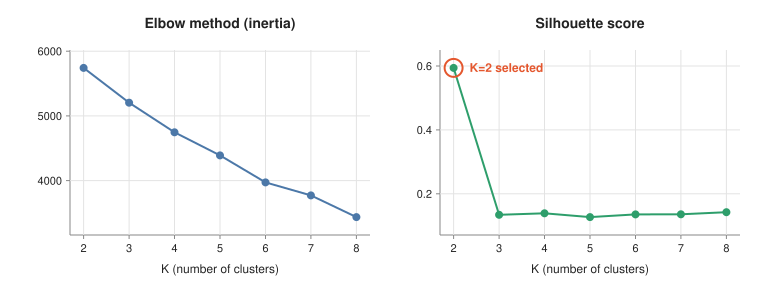
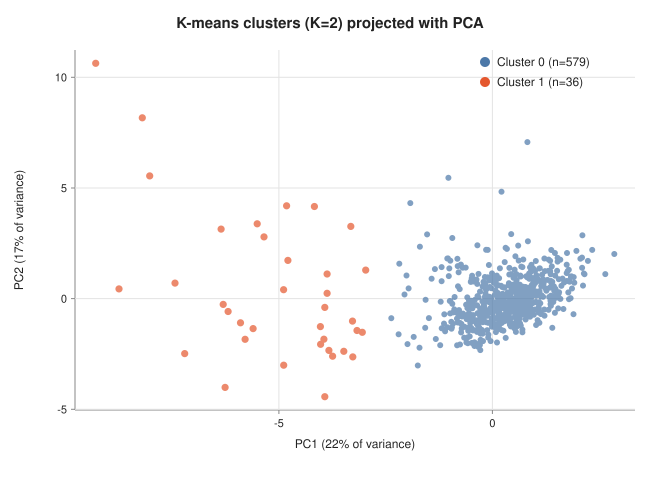
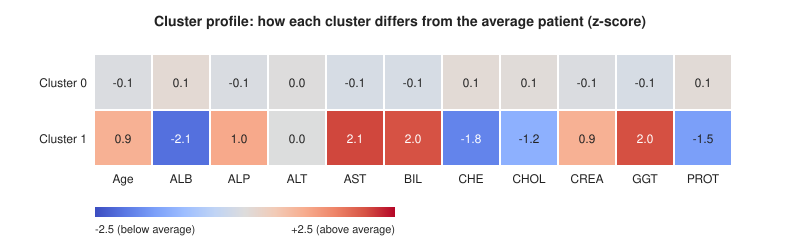
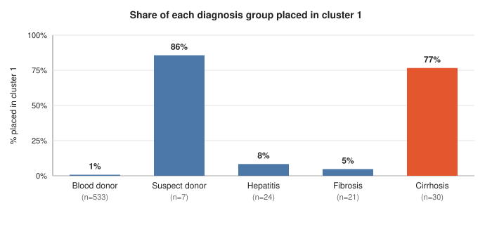

# HCV Patient Clustering with K-Means

[](https://colab.research.google.com/github/asti-nisrina02/hcv-patient-clustering/blob/main/hcv_patient_clustering_kmeans.ipynb)

Unsupervised machine learning project that groups patients using only routine blood-test values, then checks how well the groups match the real diagnosis categories.

## Project overview

- **Question:** can lab values alone separate patients into meaningful clusters?
- **Data:** [HCV data, UCI Machine Learning Repository](https://archive.ics.uci.edu/dataset/571/hcv+data): 615 patients, age, sex, 10 blood-test values and a diagnosis category.
- **Approach:** data cleaning, feature scaling, K-means with K = 2 to 8, model selection with elbow method, silhouette score and cosine-similarity measures, PCA visualisation, cluster profiling, and comparison with the true diagnosis (adjusted Rand index).

## Key findings

- **K = 2 was selected.** Its silhouette score is 0.59, while every K from 3 to 8 scores only about 0.13 to 0.14, so there is no clear structure beyond two groups.
- **The two clusters are very unequal:** 579 patients in cluster 0 and 36 in cluster 1.
- **Cluster 1 is a clearly abnormal group.** Compared with cluster 0, its patients are older (average 57 vs 47 years) and have lower albumin (29.6 vs 42.4), cholinesterase (4.1 vs 8.5) and cholesterol (4.0 vs 5.5), and much higher bilirubin (50.7 vs 8.9), AST (104 vs 30), GGT (150 vs 33) and creatinine (127 vs 78).
- **Match with the real diagnoses (never given to the model):** cluster 1 contains 23 of the 30 cirrhosis patients and 6 of the 7 suspect blood donors. Cluster 0 contains 529 of the 533 blood donors, but also 22 of 24 hepatitis and 20 of 21 fibrosis patients. The adjusted Rand index is 0.47.
- **Interpretation:** routine blood-test values separate advanced liver disease well, but they cannot tell early hepatitis or fibrosis apart from healthy donors.

All numbers come from running the notebook with `random_state=42`.

## Results

### Choosing K


### Clusters in 2D (PCA)


### What defines each cluster


### Clusters vs. real diagnoses


## Methods and tools

Python, pandas, NumPy, scikit-learn (K-means, PCA, silhouette score), SciPy, matplotlib.

## Repository structure

```
hcv-patient-clustering/
├── hcv_patient_clustering_kmeans.ipynb   # full analysis
├── data/
│   └── hcv_dataset.csv                   # HCV dataset (UCI)
├── images/                               # result charts shown above
├── requirements.txt
└── README.md
```

## How to run

1. Clone the repository and install the requirements:
   ```bash
   pip install -r requirements.txt
   ```
2. Open the notebook in Jupyter or click the Colab badge above, and run all cells. The dataset is already in `data/hcv_dataset.csv`.

## Data

Lichtinghagen, R., Klawonn, F., & Hoffmann, G. (2020). *HCV data* [Dataset]. UCI Machine Learning Repository. https://doi.org/10.24432/C5D612. Licensed under [CC BY 4.0](https://creativecommons.org/licenses/by/4.0/).

## Limitations

- Small and imbalanced dataset (most patients are healthy blood donors).
- K-means assumes roughly round, similarly sized clusters.
- Exploratory analysis only, not a diagnostic tool.

## Background

Originally built as a university data mining course assignment, then reworked for this portfolio: removed a row-index feature that leaked label information, added model selection across several values of K, visualisations, cluster profiles and a comparison with the real diagnosis categories.
